
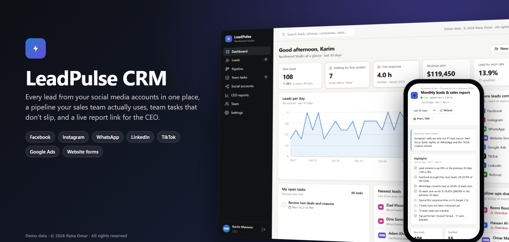

# LeadPulse CRM

**A CRM built for companies whose leads come from social media.** Every Facebook and Instagram lead form, WhatsApp chat, LinkedIn or TikTok lead, Google Ads form and website enquiry lands in one place. The sales team works it through a simple pipeline, everyone's tasks stay on track, and the CEO follows the results from a live report link without logging in.

> **This is a product showcase.** The LeadPulse CRM software and its source code are proprietary and are **not** included in this repository. See [License](#license).

## Demo video

<a href="media/LeadPulse-CRM-demo.mp4">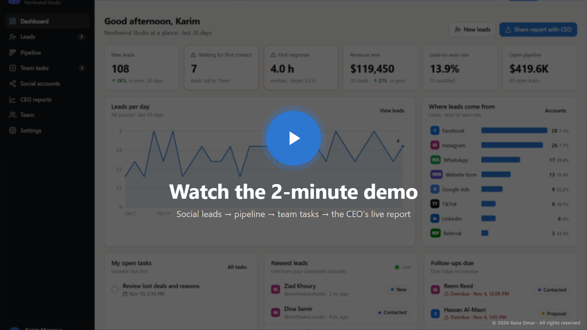</a>

A 2-minute walkthrough (1080p): leads arriving from social accounts, working a lead, the pipeline, team tasks, and the CEO's live report on desktop and phone. [Open the video](media/LeadPulse-CRM-demo.mp4).

## Features

### Leads from every social account
- **Facebook & Instagram**: one-click Meta login connects your Pages; Lead Ads form submissions and new Messenger / Instagram DMs arrive in real time, with campaign, ad and form names attached.
- **WhatsApp Business**: every new chat becomes a lead, and follow-up messages are added to its history.
- **LinkedIn, TikTok, X, Snapchat, YouTube, Google Ads and website forms**: each account gets its own secure web address that the platform (or Zapier / Make) sends leads to. Google Ads lead forms and a ready-made website form are supported out of the box.
- **Per-account performance**: leads in the last 30 days, all-time leads, deals won, win rate, a 14-day trend and an activity log for every connected account.
- **Test leads** so you can check each connection end to end before going live.

### Lead management
- One list for all leads with search and filters by stage, source, account and owner, plus CSV import and export.
- **Automatic duplicate detection** by platform ID, email or phone: a returning person is added to their existing lead instead of creating a new one.
- **Automatic assignment** to the sales team (round robin or least busy), or per-account owners.
- A lead score, follow-up reminders, and a full timeline of calls, WhatsApp chats, emails, meetings and notes.
- **First-response time** recorded for every lead, so you can see how fast the team replies.

### Sales pipeline
- Drag-and-drop board: New → Contacted → Qualified → Proposal → Won / Lost, with deal values per stage.
- Lost deals record a reason, so you can see why business is lost.

### Team tasks
- Board and list views with owners, priorities, due dates and overdue alerts.
- Every new lead automatically gets a "contact this lead" task for its owner, which closes itself as soon as someone reaches out.

### Reports for the CEO
- A live report: new leads vs the previous period, leads by source, social account performance, conversion rate, revenue won, response times, open pipeline, team performance, overdue tasks and lost-deal reasons, with written highlights.
- **Share links**: a private, read-only link the CEO opens on any phone or laptop, with no account needed. Add a note from the team, set an expiry, see how often it was opened, revoke it any time. Customer emails and phone numbers are never shown on it.
- Prints cleanly to PDF.

### Team, security and everyday use
- Roles: **Admin**, **Manager** and **Sales agent**. Agents only see their own and unassigned leads.
- Encrypted storage for social account access, signed Meta webhooks, protected sign-in and per-account secret web addresses.
- Live notifications for new leads and assignments, light and dark mode, and a layout that works on phones.

## Screenshots

| | |
|---|---|
| 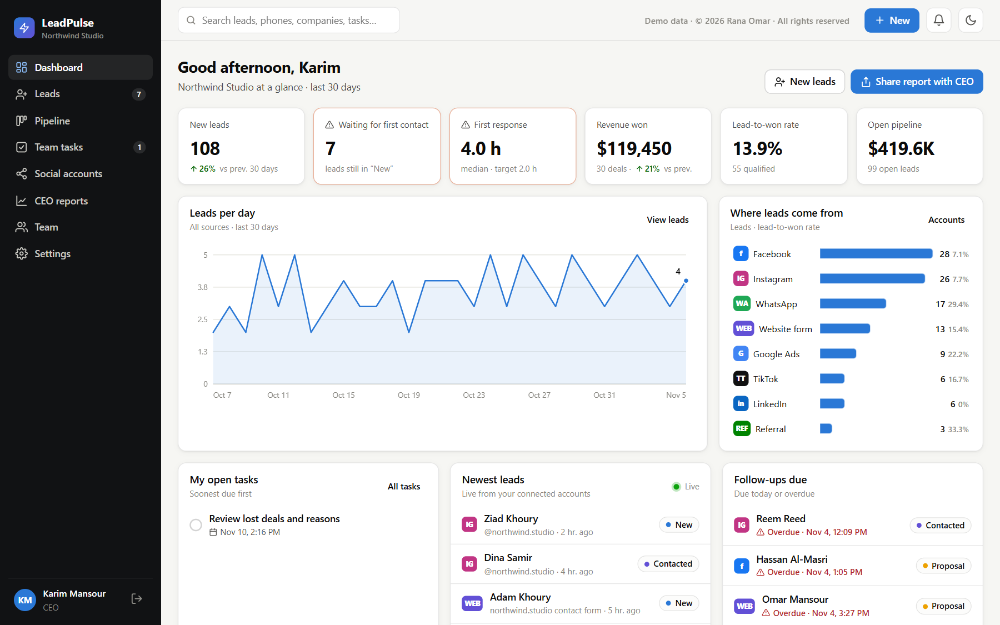 **Dashboard**: new leads, first-response time, revenue, pipeline, tasks and follow-ups due. | 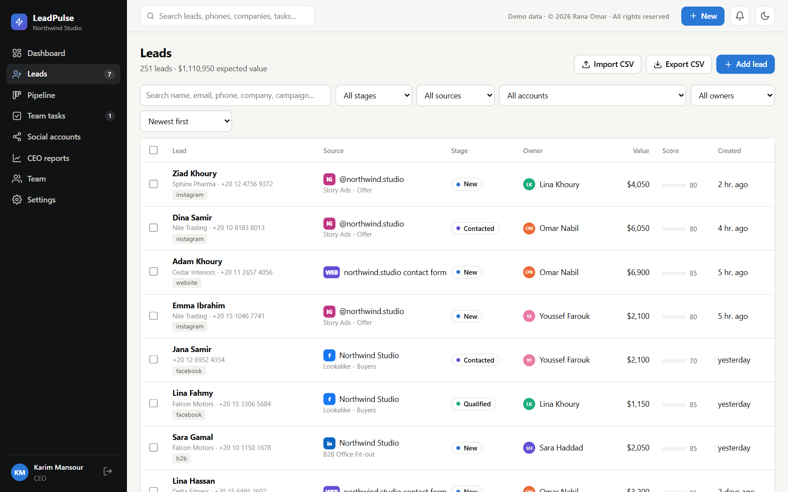 **Leads**: every lead with its source, account, stage, owner, value and score. |
| 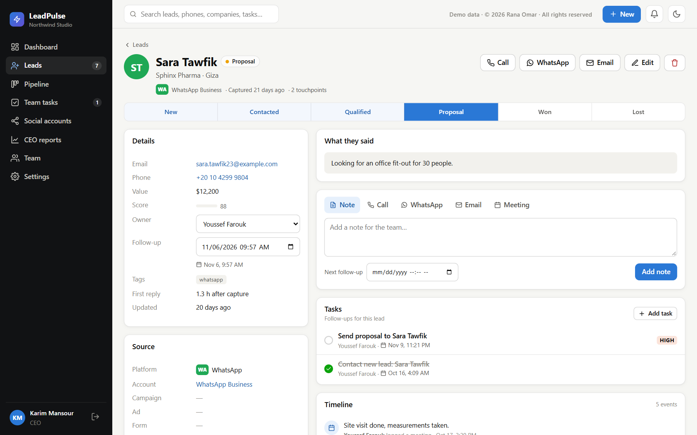 **Lead page**: contact details, where the lead came from, tasks and the full timeline. | 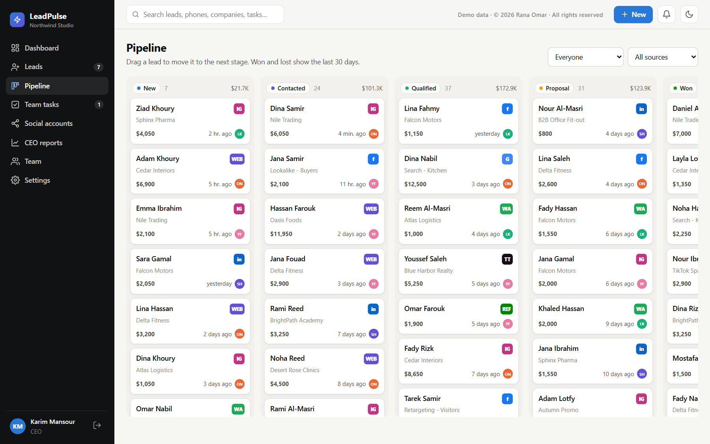 **Pipeline**: drag deals from stage to stage. |
| 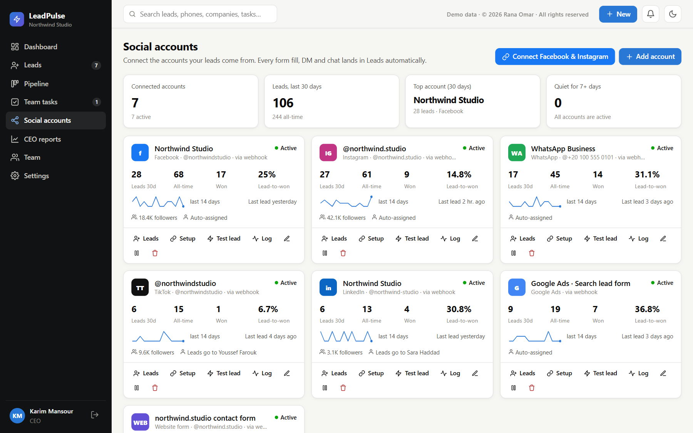 **Social accounts**: leads, wins and trends per connected account. | 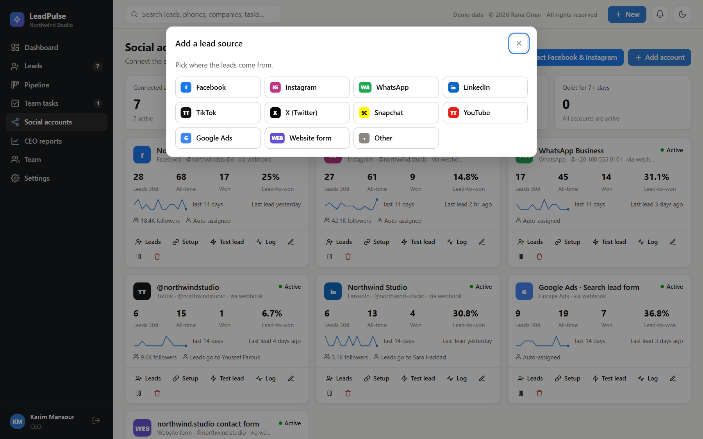 **Connect a lead source**: Facebook, Instagram, WhatsApp, LinkedIn, TikTok, X, Snapchat, YouTube, Google Ads and websites. |
| 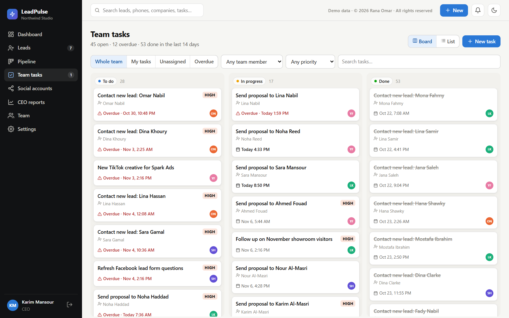 **Team tasks**: owners, priorities, due dates and overdue alerts. | 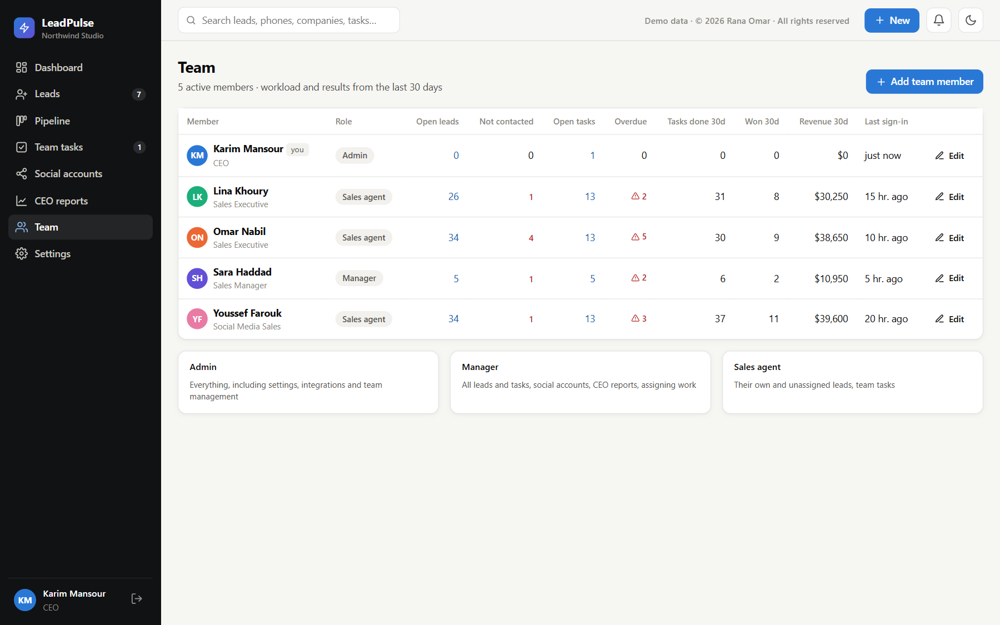 **Team**: workload and results for each person. |
| 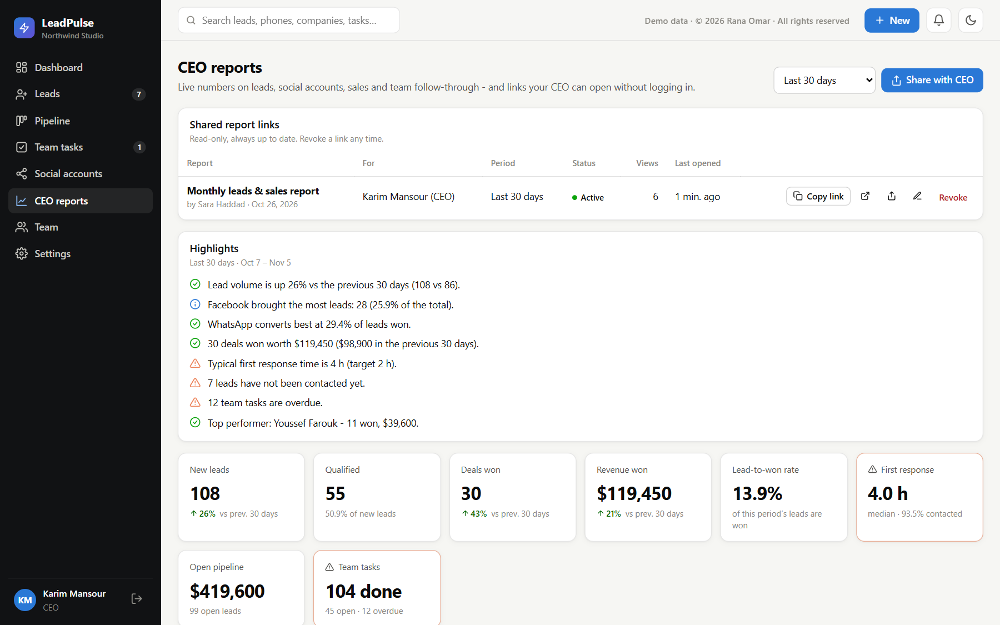 **CEO reports**: share links and the live report. | 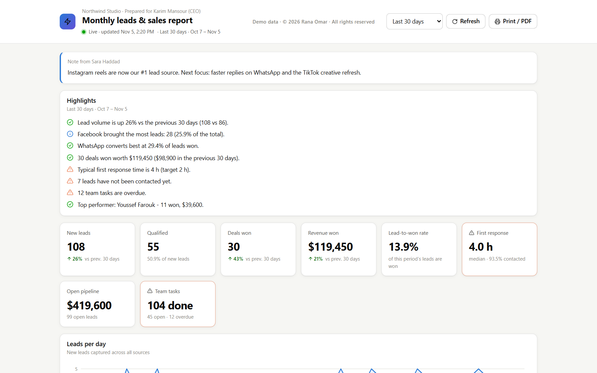 **What the CEO sees**: the live report, no login needed. |
| 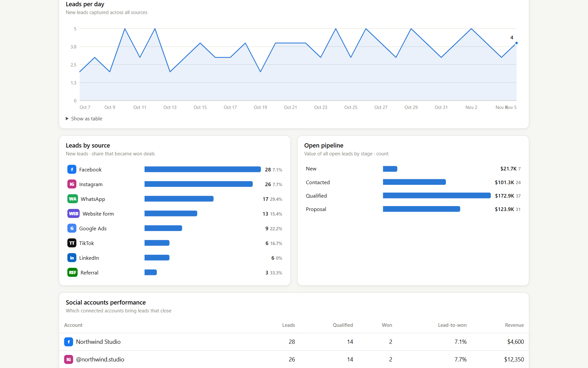 **Team performance** in the CEO report. | 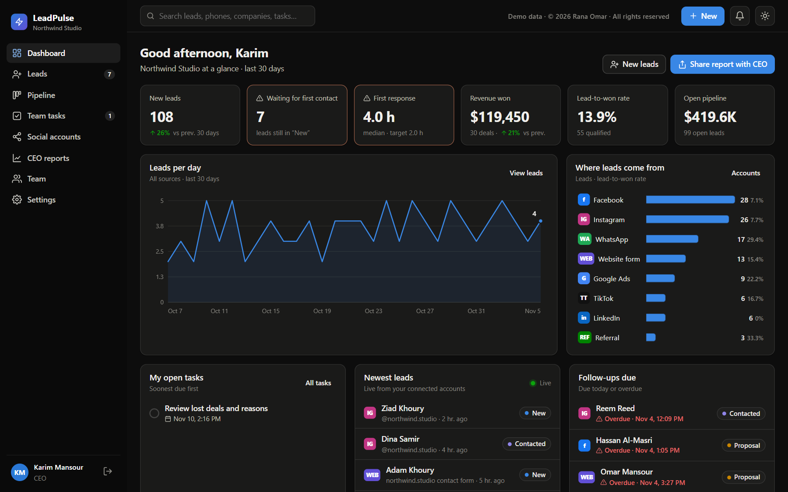 **Dark mode**. |

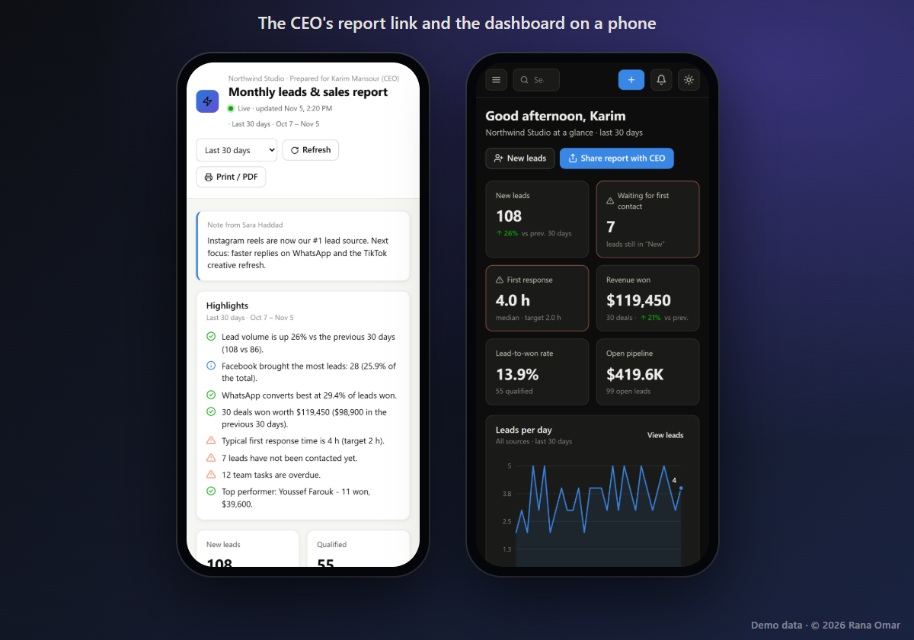

All names, companies and figures in these screenshots and the video are fictional demo data.

## Interested?

LeadPulse CRM is available for companies on request. Contact [@rana537omar](https://github.com/rana537omar) for a live demo or licensing.

## License

**Copyright © 2026 Rana Omar. All rights reserved.** The text, screenshots, images and video in this repository are shared for viewing only. No license is granted to copy, reuse, modify, republish or use them, or the LeadPulse CRM software they show, for any personal or commercial purpose. See [LICENSE](LICENSE).
